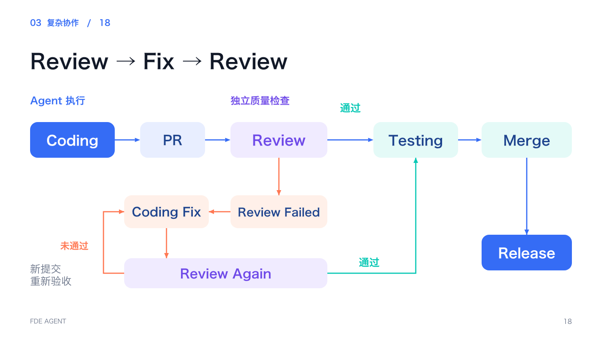
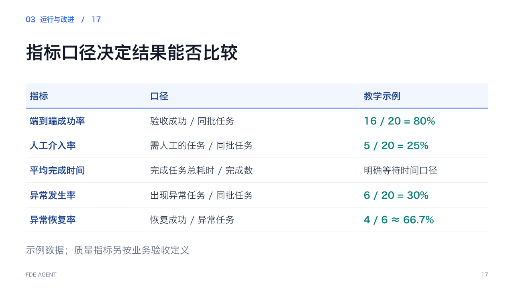

# Visual-first PPT Skill

一套可复用的演示文稿制作 Skill，适用于课程、演讲、技术分享、产品介绍、路演与汇报。支持从资料新建、沿用风格增补知识，以及表格和局部版式优化。

**内容深、页面清、图表可编辑。** 知识深度、单页信息密度与总页数分别设计；增加原理、决策、案例、异常与验收证据，同时保留讲述空间。

## 使用

将本仓库放入支持 Agent Skills 的工具所识别的 Skill 目录，文件夹建议命名为 `visual-first-ppt`。入口为 [SKILL.md](SKILL.md)，调用名称保持 `$visual-first-ppt`。

新建课件：

> 使用 $visual-first-ppt，根据这份讲义制作现场培训课件。用统一风格的原创插画和可编辑技术图表，保留完整讲师备注，完成渲染检查并交付 PPTX。

补充知识：

> 沿用当前 PPT 的视觉风格，依据原始资料补足知识深度。增加原理、判断依据、实施细节、异常与案例，需要时新增页面，并同步更新 Notes 和授课时间。

优化表格：

> 使用 $visual-first-ppt，把表格改成浅色表头、白底细线的现代样式，突出关键数值与状态，保留原有文字、数据、备注和其他页面内容。

无需填写固定表单；页数、课时、配色和结构由任务决定。

## 工作方式

- **教学深度**：原始资料与嵌入表格建立覆盖对照；重要知识进入页面、Notes 或演示。关键推理不能全部藏进备注。
- **参考防漂移**：将满意样稿与内容来源分开，提取实测视觉参数；代表页同尺寸并排检查，避免关系图退化为说明条、截图固定搭配三段文字。
- **视觉表达**：每次按课件内容调用 ImageGen，使用 Skill 的风格生成所需插图；参考图片不作为固定图库。文字、数字、架构、流程和表格采用原生组件。
- **现代图表**：浅色表头、细横线、深色语义强调；检查旧表格主题带来的隐藏网格和色带。
- **局部修改**：保留最新批准稿的其他内容；样式导出有副作用时可用受限的原生表格移植工具。
- **交付检查**：实际渲染修改页，核对整体节奏、内容、Notes、可编辑性和文件完整性。
- **可靠性检查**：明确来源页映射，防止样板扩展错配备注；检查最终 PPTX 的空媒体、断链和声明的文字/表格/图片保留项，避免“能导出但内容已丢失”。

## 视觉示例

以下是完成课件后的渲染示例，用于理解布局与风格，不是整页图片模板。新课件的标题、图形与表格仍应原生可编辑。





## 文件说明

| 文件 | 用途 |
| --- | --- |
| [SKILL.md](SKILL.md) | 模式选择、核心规则和按需阅读入口 |
| [agents/openai.yaml](agents/openai.yaml) | Skill 列表展示与调用示例 |
| [Storyboard](references/storyboard-template.md) | Brief、内容覆盖和逐页卡片 |
| [教学深度](references/teaching-depth.md) | 资料增补、页面与备注分工、时间安排 |
| [参考基准与风格防漂移](references/reference-fidelity.md) | 满意样稿锁定、FDE 风格档案、代表页对照与漂移修复 |
| [视觉系统](references/visual-system.md) | 配色、字号、网格与原生技术图 |
| [ImageGen 工作流](references/imagegen-playbook.md) | 按内容生成插图、统一风格、生成记录与局部修订边界 |
| [原生表格](references/native-tables.md) | 表格样式参数与主题陷阱 |
| [编辑与交付](references/editing-and-delivery.md) | 局部保留、渲染与文件检查 |
| [内容一致性与可靠导出](references/reliability.md) | 来源映射、重试恢复、二进制资源与内容验收 |
| [QA 清单](references/qa-checklist.md) | 内容、视觉、原生对象与最终产物验收 |
| [现场教学示例](examples/live-training-example.md) | 从概念扩展到决策、案例与演示 |
| [表格样式保留工具](scripts/preserve_table_styles.py) | 只移植经过原生工具编辑的表格样式 |
| [PPTX 文件与内容检查工具](scripts/validate_pptx.py) | 检查空媒体、关系、页序及声明的内容保留要求 |

`assets/style-references/` 与 `assets/slide-examples/` 只用于风格和构图对照，不是固定插图库，也不能裁出其中的插画用于新课件。每次根据当前内容调用 ImageGen 生成所需插图。示例中的课程标题、时间与数字不构成通用模板要求。

## 可选工具与验证

核心 Skill 不绑定演示文稿库或操作系统；制作时使用当前可用的原生编辑、图像生成和渲染工具。辅助脚本只需 Python 3 标准库。表格移植适用于文字、合并、行列尺寸、顺序与主题上下文不变的纯文本原生表格。文件检查可结合输入清单或显式内容要求使用，详见 [可靠导出](references/reliability.md)。两者都不会替代原生编辑、图像解码或视觉检查。

运行脚本测试：

```bash
python3 -m unittest discover -s tests -v
```

有 skill-creator 的环境还可使用其 `quick_validate.py` 检查 Skill 元数据。脚本用法和拒绝条件见 [编辑与交付](references/editing-and-delivery.md)。
